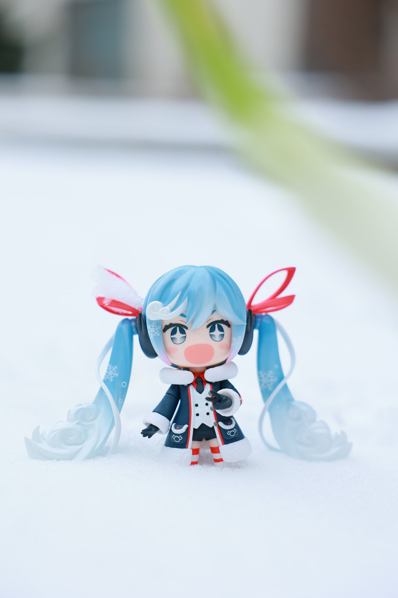

# 潘宇轩 · 摄影作品集

一个纯手写的摄影网站：**没有框架、不用安装任何东西**，双击 `index.html` 就能打开。

```
我的个人主页/
├── index.html      ← 摄影版主页（现在这个）
├── index-v1.html   ← 旧版「个人简介」页面（备份，双击也能看）
├── styles.css      ← 样式和配色
├── script.js       ← 交互（滚动动画、深浅色、复制邮箱、看大图）
├── favicon.svg     ← 浏览器标签上的小图标
├── assets/         ← 放照片（photos 文件夹已建好）
└── README.md       ← 就是这份说明
```

---

## 一、先看效果

**最快**：双击 `index.html`，浏览器直接打开。

**可选**：装了 Python 的话，在文件夹里运行 `python3 -m http.server 8000`，再访问 <http://localhost:8000>。

> 两种方式效果一样，双击就够了。

---

## 二、换成你自己的照片（最重要的一步）

现在的彩色块是**占位图**，换成真照片后就完全不一样了。

1. 把照片放进 `assets/photos/`；
2. 命名成下面这些，然后打开 `index.html`，**去掉 `` 前后的 `<!--` 和 `-->`**：

| 照片 | 文件名 | 在哪 |
|---|---|---|
| 首屏大图 | `featured.jpg` | 页面顶部那张横图 |
| 照片墙 01–07 | `01.jpg` … `07.jpg` | 「照片」那一区 |
| 你的照片 | `me.jpg` | 「关于」右边 |

改之前长这样：

```html
<!--  -->
```

改之后长这样（就是把注释符号删掉）：

```html

```

> **照片建议**：宽度 1600px 左右、存成 jpg、每张压到 300KB 以内，网页打开才快。`alt` 里写一句这张拍的是什么。

---

## 三、改文字（搜 ✏️，一共 8 处）

| 编号 | 位置 | 改什么 |
|---|---|---|
| ✏️ 1 | `<head>` | 浏览器标签标题、简介 |
| ✏️ 2 | 首屏 | 一句话说清你在拍什么 |
| ✏️ 3 | 大图 | 换成最想放大的那张 + 图注 |
| ✏️ 4 | 照片墙 | 每张的标题、年份、`data-caption` |
| ✏️ 5 | 关于 | 你的故事（越具体越好） |
| ✏️ 6 | 关于右侧 | 你的照片 + 信息卡（学校、设备、后期…） |
| ✏️ 7 | 近况 | 在拍 / 在学 / 在找 |
| ✏️ 8 | 联系 | 邮箱（**改两处**）+ 社交链接 |

改完按 `Ctrl/⌘ + S` 保存，回浏览器 `Ctrl/⌘ + R` 刷新。

### 换配色

打开 `styles.css`，最上面的「1. 颜色变量」改 `--accent`（现在是朱红 `#e8471f`）。
摄影站想更"胶片"一点，可以试试 `#c1502e`、`#8c7b6b` 这类低饱和的颜色。

---

## 四、发布到网上

最推荐 **GitHub Pages**，免费、稳定，还能写进简历。

1. 注册 [GitHub](https://github.com)，新建仓库（Public）；
2. 把 `我的个人主页` 里**所有**文件上传上去（Add file → Upload files）；
3. 仓库 **Settings → Pages**：Source 选 `Deploy from a branch`，Branch 选 `main` / `(root)`，Save；
4. 等 1–2 分钟，顶部会出现网址：`https://你的用户名.github.io/仓库名/`。

> 仓库名叫 `你的用户名.github.io`，网址就会变成 `https://你的用户名.github.io`。

**更省事**：[Netlify Drop](https://app.netlify.com/drop)，把整个文件夹拖进去，几秒出网址。

---

## 五、常见问题

**Q：点了照片没反应？**
照片墙的按钮需要 JS，确认 `script.js` 和 `index.html` 在同一个文件夹里。

**Q：点了照片弹出提示？**
那是「系列」卡片，还是占位链接。改成你的作品地址（或者先删掉 `data-placeholder` 和 `href="#"`）。

**Q：照片太大加载慢？**
压到 300KB 以内。可以用 [Squoosh](https://squoosh.app/) 在线压缩。

**Q：想要回以前那版？**
双击 `index-v1.html` 就能看。想换回来，把它改名叫 `index.html` 就行（记得先把现在这个改个名备份）。

---

## 六、「专区」怎么维护

页面上那块深色的 **「小人的日常」** 是手办摄影专区，和上面的照片墙是分开的。

- **加照片**：复制一整块 `<figure class="zone__item reveal">`（从 `<figure` 到 `</figure>`），改里面的 `src` 和图注；
- **改张数**：把 `2 张 · 2025—2026 · 持续更新` 里的数字改掉；
- **改名字**：改 `<h2 class="zone__title">` 里的字，导航栏的「专区」也会指到这里；
- **那一格虚线框**：是「更多照片陆续补上」的占位，照片够了直接删掉它，或改成一个新的 figure；
- 想再加一个专区（比如「街头」「人像」）？把整个 `<section class="section zone" id="zone">` 复制一份，改 `id` 和内容就行。

---

用 HTML / CSS / JavaScript 手写 · 照片是你自己的，光也是。
